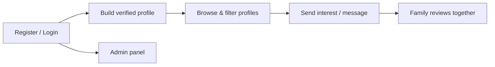

<a id="top"></a>
<p align="center">
  
</p>

<p align="center">
  
</p>

<p align="center">
  <a href="https://rishta-elite.vercel.app"></a>
  <a href="https://github.com/shahidabuali/RishtaElite"></a>
  <a href="https://github.dev/shahidabuali/RishtaElite"></a>
  <a href="https://github.com/shahidabuali/RishtaElite/issues/new"></a>
  <a href="https://shahidas-portfolio.vercel.app/"></a>
  <a href="https://www.linkedin.com/in/shahidabuali/"></a>
</p>

<p align="center">
  
  
  
  
</p>

## 📑 Contents

[The pitch](#pitch) · [Take the tour](#tour) · [Features](#features) · [Flow](#flow) · [Run locally](#run) · [Author](#author)

<a id="pitch"></a>
## 💛 The pitch

A bilingual (English / اردو) matchmaking platform concept for Pakistani families — built as a design-heavy front-end prototype with verified-profile workflows, privacy controls, family co-access, membership tiers, messaging and an admin panel.

<a id="tour"></a>
## 🗺️ Take the tour

| Page | What's inside |
| --- | --- |
| [index.html](rishta%20website/index.html) | Landing page: animated preloader, orbit animation, jaali pattern, how-it-works, membership tiers, testimonials |
| [profiles.html](rishta%20website/profiles.html) | Searchable profile cards with gender / country / age / marital-status filters |
| [messages.html](rishta%20website/messages.html) | Inbox view with unread badge |
| [profile-viewers.html](rishta%20website/profile-viewers.html) | Who viewed your profile |
| [register.html](rishta%20website/register.html) · [login.html](rishta%20website/login.html) · [reset-password.html](rishta%20website/reset-password.html) | Demo auth flows |
| [contact.html](rishta%20website/contact.html) | Contact form |
| [Admin.html](rishta%20website/Admin.html) | Admin panel |
| [App.js](rishta%20website/App.js) | All the demo logic: data store, auth, filters, profile modal, toasts |
| [style.css](rishta%20website/style.css) | Design system: light/dark themes, animations, cards, grids |

<a id="features"></a>
<details>
<summary>✨ Interaction checklist — click to expand</summary>

- [x] **EN / UR language switch** across the whole landing page
- [x] Dark / light theme toggle with animated sun/moon icons
- [x] Hand-drawn preloader with animated logo, letter reveal and progress bar
- [x] Hero orbit animation with canvas ripple and floating avatars
- [x] Cursor glow, magnetic buttons, scroll reveals and staggered entrances
- [x] 3D tilt on membership cards; hover-reveal "chroma grid" testimonials
- [x] Six seeded demo profiles with search, filters, verified badges and interest buttons
- [x] Membership tiers: Free, Premium (PKR 2,500/mo) and VIP (PKR 6,000/mo)
- [x] Demo auth (register, login, logout), messages, profile viewers and admin panel

</details>

<a id="flow"></a>
<details>
<summary>🏗️ How the flows connect — click to view the diagram</summary>



</details>

<a id="run"></a>
<details>
<summary>▶️ Run it locally — click for commands</summary>

```bash
cd "rishta website"
python -m http.server 8000
# open http://localhost:8000/index.html
```

Supabase config is no longer stored in source. Copy `config.example.js` to `config.js` and add your own values locally; `config.js` is git-ignored. The front-end demo itself still uses `localStorage`.

</details>

<p align="center">
  
  
  
</p>

<a id="author"></a>
<p align="center">Designed and coded by <a href="https://github.com/shahidabuali">Shahida Bu Ali</a> · <a href="https://shahidas-portfolio.vercel.app/">Portfolio</a> · <a href="https://www.linkedin.com/in/shahidabuali/">LinkedIn</a></p>

<p align="center"><a href="#top">↑ Back to top</a></p>
